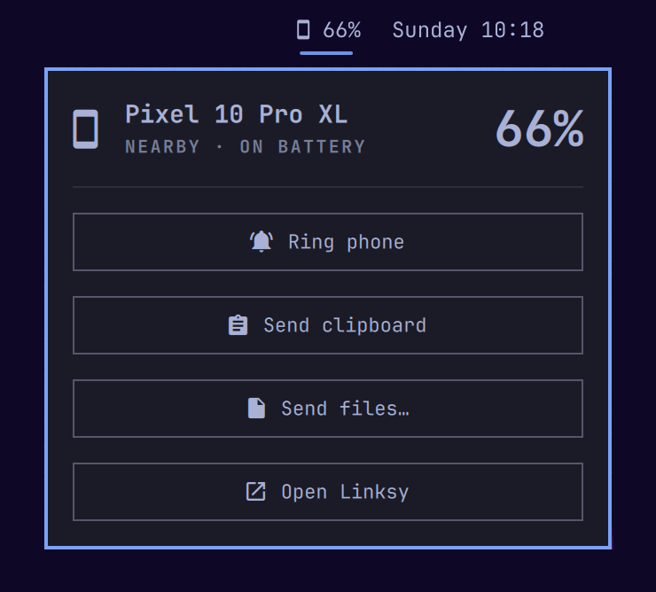

# Linksy for the Omarchy bar

An [Omarchy](https://omarchy.org) bar widget for [Linksy](https://linksy.diary.mg), which connects an Android phone with your Linux computer.



While your paired phone is on the same network, the bar shows it with its battery level, for example `󰄜 69%`. Click it for a popup with:

- **Ring phone**, to find it
- **Send clipboard**, to send this computer's copied text to the phone
- **Send files…**
- **Open Linksy**

Right-click opens Linksy. The widget hides when no paired phone is around, and shows transfer progress (`󰓢 42%`) while files are moving.

## Requirements

- Omarchy with the Quickshell bar ("Quattro")
- [Linksy](https://linksy.diary.mg) 0.9.9 or newer, with the `linksyd` service running and a phone paired
- The `zenity` package, only for **Send files…**

`jq`, `python3` and `wl-clipboard` come with Omarchy.

## Install

```bash
omarchy plugin add https://github.com/ShinobiX9X/omarchy-linksy --enable
```

To put it left of the clock:

```bash
omarchy bar move io.github.shinobix9x.linksy --before omarchy.clock
```

## Remove

```bash
omarchy plugin remove io.github.shinobix9x.linksy
```

This removes the widget only. Linksy itself stays installed.

## How it works

The widget reads the phone list from Linksy's local service (`$XDG_RUNTIME_DIR/linksyd.sock`), and refreshes it whenever the service reports a change. The buttons run the `linksy` command.

The widget shows a phone while it's **nearby** (found on your network), not only while it's **connected**. Linksy connects only when something happens and drops the connection after a minute idle. Android also stops announcing the phone now and then, so the widget waits 3 minutes before hiding it.

## When a Linksy update breaks it

That service is Linksy's internal interface, not a published API, so a Linksy update can change it. The widget checks this itself:

- **When it checks:** each time it meets a Linksy version it hasn't checked yet, it runs `check.sh`. That tests the phone list's format, the event names it uses and the `linksy` commands its buttons run.
- **If something changed:** it shows `󰄜 !` instead of guessing. You get one notification, and the popup lists what changed.

Then:

1. Update the widget: `omarchy plugin update io.github.shinobix9x.linksy`
2. No fix yet? [Open an issue](https://github.com/ShinobiX9X/omarchy-linksy/issues) with the output of:

   ```bash
   ~/.config/omarchy/plugins/io.github.shinobix9x.linksy/check.sh
   ```

If the bar still shows the old widget after an update, restart the shell with `omarchy restart shell`.

## Privacy

Linksy keeps its data, such as clipboard files from your phone, in its data folder: `$XDG_DATA_HOME/linksy`, which is `~/.local/share/linksy` unless you changed it (or the folder given to `linksyd --data-dir`). On a computer with more than one account, close that folder to everyone else, including shared groups:

```bash
chmod 700 "${XDG_DATA_HOME:-$HOME/.local/share}/linksy"
```

Do this whether or not you see a warning. `check.sh` warns once when it finds the folder open, looking at the folder the running `linksyd` uses and at permissions for other accounts and shared groups, but it can't see every setup (ACLs, for example). The widget itself reads only Linksy's service socket, which is private to you.

## License

[MIT](LICENSE)
